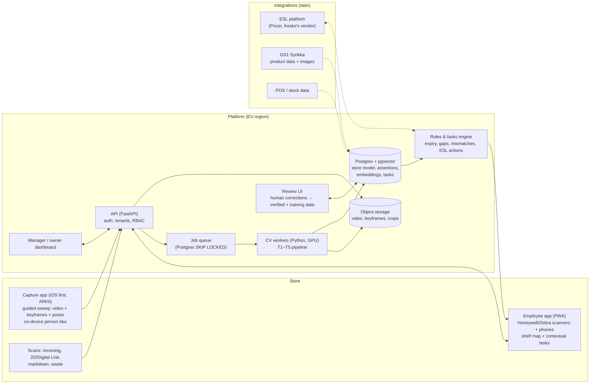
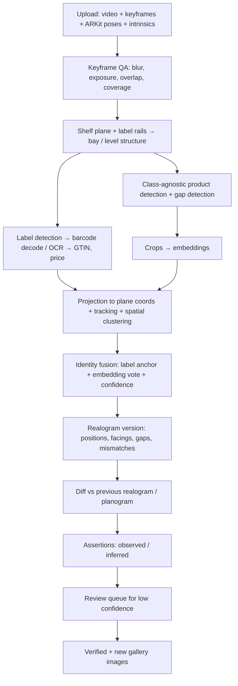
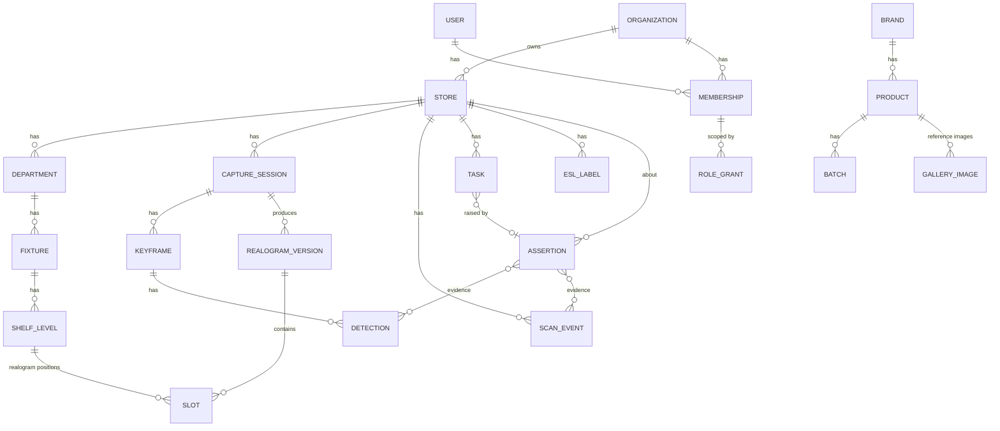

# Shelf intelligence platform: audit, research and direction

Written 2026-11-10 in response to the "Shelf Intelligence" brief. **No code has been changed.** This is a basis for decisions, not a decision.

## 0. Ambition and outcomes

**Petteri, 2026-11-10:** The project is not locked to Finland; Finland is simply the easiest place to start. It is very ambitious and will most likely end as portfolio work, but it should be done as well as possible, and big.

That gives two rules for everything below:

1. **Start in Finland, design for anywhere.** Finnish stores, language and contacts for the first pilot. But nothing in the data model, standards or architecture may assume Finland (§9.1).
2. **Every milestone must pay off on both paths.** If the project becomes a company, each step is a step towards a product. If it stays portfolio work, each step still leaves something real: a working system, measured results, and a documented learning path. No milestone is "only useful if we get funding".

| Outcome | What success looks like |
|---|---|
| **Product path** | Signed pilot with a retailer → measured € and hours → paying stores → Nordic expansion |
| **Portfolio path** | A working capture → realogram → shelf map → task → scan loop on real store data, with honest evaluation numbers, and case studies that show product thinking, CV engineering, data modelling and UX in one project |
| **Learning path** | Hands-on experience across camera geometry, detection, OCR, embeddings, tracking, data engineering, multi-tenant architecture and accessibility-first UX |

The validation spikes in §10 are chosen so that each one is publishable on its own (a short write-up with data, method, metric and result), whatever happens to the product.

Contents:

1. [Audit of Hyllykartta](#1-audit-of-hyllykartta)
2. [Competitors](#2-competitors)
3. [Feasibility of the CV pipeline: the three hard questions](#3-feasibility-of-the-cv-pipeline-the-three-hard-questions)
4. [Technical unknowns, ranked](#4-technical-unknowns-ranked)
5. [Product architecture](#5-product-architecture)
6. [Data model](#6-data-model)
7. [Technology recommendations](#7-technology-recommendations)
8. [Product experience and roles](#8-product-experience-and-roles)
9. [Commercial opportunity in Finland](#9-commercial-opportunity-in-finland)
10. [Development strategy](#10-development-strategy)
11. [Where I disagree with the brief](#11-where-i-disagree-with-the-brief)
12. [Sources](#12-sources)

---

## 1. Audit of Hyllykartta

What exists (built 2026-11-10, nothing committed yet):

| Part | What it is | Worth keeping because |
|---|---|---|
| `docs/research/report.md` | Sourced research: GS1 2D / Sunrise 2027, Finnish pilots, NorgesGruppen −18 %, Aalto ~−10 %, Luke waste figures, EU 2025/1892, back-picking 45 % in dairy, Digital Link syntax | Market and standards facts with confidence levels; most still unverified (`verification.md`) |
| `sim/model.js` | Day-by-day model of one dairy shelf; four strategies; paired Monte Carlo | Becomes the **value model / ROI calculator**. Its parameters are exactly what a pilot must measure |
| `app/` | Phone prototype: Digital Link scan receives a batch or confirms a task; one task at a time; shelf map with icon + word | The **employee UX reference**. Proves the scan-to-receive / scan-to-confirm loop |
| `docs/design-principles.md` | P1 newest employee, P2 not excluding, P3 beyond dairy, P4 prompt don't assert, P5 label ≠ rescue | Carry over unchanged. P4 is the seed of the observed / inferred / verified model below |
| `docs/field-notes.md` | Petteri's shop-floor experience, model corrections, interview questions | Primary-source domain knowledge |
| `docs/ideas.md` | I1: ESL auto-discount when a batch is alone on the shelf | Becomes much stronger after this research (§2, §9) |

**Key findings so far:**
- In the model, the value of a shelf map comes from **staff time and consistency across employees**, not from margin. The data map's result does not depend on who works; today's routine does.
- The model's **biggest weakness**: the shelf map is assumed to exist and to be correct. In reality someone has to build it and keep it up to date as assortments change. **That is exactly the job computer vision should do.** This is the most important link between the old project and the new one.
- **The two most important parameters have no published data:** how long a date check takes, and how long dairy sits on the shelf. A pilot must measure them.

**What to keep, what changes:** Hyllykartta becomes the **expiry module** and the first use case. Its thesis extends:

> **2D codes tell what and when. Vision tells where. Scans make it true.**

---

## 2. Competitors

| Company | What | Capture | Relevance |
|---|---|---|---|
| **Clobotics** | OSA, planogram compliance, pricing & promotions, coolers, **"Freshness & Expiry"**, virtual store management. Customers are mostly CPG brands (Coca-Cola, Danone, Carlsberg…) | Mobile app with stitching; video since 2025. One App Store review complains that capture takes many attempts | CPG retail-execution player. Sells to brands, not mainly to grocers |
| **Scandit ShelfView** | Walk-through video with on-screen guidance → "digital shelf twin": OOS, low stock, planogram, price-tag mismatches. Claims 99.7 % alert accuracy (vendor figure) | Phones, Zebra TC5x/7x, iPhone; also fixed cameras and robots | **Closest competitor.** Already on store devices, already in Europe (Ahold, Carrefour Poland) |
| **Scandit Smart Label Capture + Expiry Management & Markdowns** | Reads barcode and printed expiry date in one pass, flags markdowns; claims up to 40 % less waste (vendor figure). Says expiry capture covers only ~30 % of stores at leading grocers | Phones and terminals | **Direct competitor for the expiry use case** |
| **VusionGroup Captana / EdgeSense** | Shelf micro-cameras + ESL rails: OOS, price errors, planogram, product geolocation. Carrefour France rollout to all hyper- and supermarkets by 2030 (>€150 M capex); Walmart US. Edeka store: OSA +5 % | Fixed cameras on the rails | Infrastructure play; huge capex; shows where ESL vendors are going |
| **Simbe (Tally)** | Robots; "Virtual Tour"; expanding into fresh departments | Robots | Big-box US model; not Finnish-scale |
| **Trax, ParallelDots, Neurolabs, Vispera, Shelfie, Focal Systems** | Image recognition for CPG retail execution; Neurolabs uses synthetic data | Mostly photos from merchandisers or fixed cameras | Crowded market for brand audits |
| **Freshflow** ($10 M Series A), **Foodforecast** (€8 M) | AI ordering for fresh, staff app for checking produce | Software | Waste reduction through ordering, not vision |
| **Pricer** (S-Group's ESL vendor), Kesko's ESLs | ESL platforms, cloud APIs | Labels | **Integration partners**, not competitors (§9) |

No Finnish start-up doing shelf vision for expiry turned up in the searches.

**What this means:**
- Generic shelf recognition (OOS, planogram) is solved well enough by well-funded players with existing customers. **A solo founder cannot win on recognition accuracy.**
- **Scandit already sells "phone video → shelf twin" and "expiry capture"**, but as separate products. Its expiry tool reads printed dates one product at a time; it does not join batches to shelf positions.
- **The open space** is the join between them: batch data (2D codes, receiving scans) × shelf position (vision, ESL rails) × employee workflow, designed for Nordic fresh departments.

---

## 3. Feasibility of the CV pipeline: the three hard questions

### Q1. Shelf reconstruction: how reliably can an ordinary phone video become a structured shelf model?

**Short answer:** reliably enough for **structure** (bays, shelf levels, label positions) if capture is guided and uses the phone's AR tracking. Unreliable for full 3D product geometry, and that is not needed.

**Why it is hard:**
- A shelf is almost a plane, but products sit 0–50 cm behind the shelf edge. A walking camera creates **parallax**, so classic panorama stitching (one homography) produces ghosting and double products.
- Narrow aisles: from 1–1.5 m away a phone cannot see a 2 m tall bay in one frame. It has to sweep.
- Motion blur and video compression destroy small text (labels, barcodes).
- Dairy coolers: glass doors, reflections, condensation, cold-air curtains, LED glare.
- People in frame (customers, staff): GDPR.

**Recommended approach: do not reconstruct the products in 3D. Reconstruct one plane, the shelf front.**
1. **Native capture app with ARKit (iOS) / ARCore (Android).** Records a camera pose (visual-inertial odometry) for every frame and detects vertical planes. This gives metric scale and removes most of the reconstruction problem. A browser cannot do this on iOS, so the capture app has to be native.
2. **Guided sweep:** the app shows a live outline of the bay and what has been covered, warns when moving too fast or too close, and saves sharp **keyframes as full-resolution stills** next to the video. Video for coverage and tracking, stills for reading text.
3. **The shelf-front plane** comes from AR plane detection plus the detected label rails (horizontal lines of shelf-edge labels). Everything is projected onto this plane in centimetres: **"realogram coordinates"**.
4. **Shelf levels = label rails.** Each rail is a line in plane coordinates; the bay is the stack of rails between uprights.

**Expected accuracy (hypothesis to test in spike T1):** labels located on the plane within ±2–3 cm; a facing's horizontal position within about half a facing width. Good enough to say "product X is at bay 4, shelf 3, 40–52 cm from the left".

### Q2. Product recognition: how far can we get at SKU level without training every product?

**Short answer:** much further than "train a class per SKU", **if identity comes from the shelf-edge label and vision only checks what is above it.**

**Why pure visual SKU recognition is hard here:**
- Finnish dairy is full of **near-identical variants**: the same yoghurt design in 150 g / 200 g / 1 kg, 10 flavours, lactose-free versions. Research on fine-grained retail recognition shows that zero-shot vision-language models do poorly on these differences; combined CLIP + DINOv2 embeddings with few-shot prototypes do better (MIMEX, 2024).
- Assortments change weekly, so per-SKU classifiers go stale.
- Seen from the front at an angle, often half hidden.

**Recommended approach: label-anchored recognition, in three layers.**

| Layer | Question | Method | Needs per-SKU training? |
|---|---|---|---|
| 1. **Label → identity** | What should be here? | Detect shelf-edge labels; decode the barcode if visible; OCR the product name, price and article number. ESL systems already link each label to a GTIN | No. Labels are a few templates per chain |
| 2. **Presence / gap** | Is something there? | Class-agnostic "product" detector (one class), trained on dense-shelf data plus our own frames; gap = no product above a label's span | No. One class |
| 3. **Verification** | Is it the right product? | Embedding (DINOv2 / SigLIP) of the crop vs. a **gallery** for the label's GTIN. Gallery from GS1 Synkka product images where available, plus our own crops that layer 1 has already labelled | No classifier; a gallery that grows by itself |

Why this works:
- The hard open-set problem ("which of 20,000 SKUs is this?") becomes a **verification problem** ("is this the product the label says?") with a strong prior.
- **The gallery builds itself.** Every confident label-anchored crop becomes a new reference image, with no manual labelling. That is the data flywheel and the main CV learning project.
- Mismatches are a product feature in themselves: "label says A, shelf shows B" is a planogram or label error worth a task.

**Limits:**
- Labels can be wrong or missing. Unanchored products need open-set retrieval and human review.
- Can a phone video read an ESL barcode? Probably not from 1 m in video frames; maybe from keyframe stills. **Spike T2.** Text OCR (name + price) is the fallback.
- **Vision does not see expiry dates of products behind the front row.** Dates come from 2D codes and scans, never from shelf video. Vision might read a printed date on the front unit in close-up, but treat that as a bonus, not a source.

### Q3. Spatial intelligence: merging the same product seen in many frames into one real shelf, without duplicates

**Short answer:** do the merging **in shelf-plane coordinates, not in image space.** With AR poses this is a clustering problem, not a stitching problem.

**Pipeline:**
1. Per keyframe: detections (labels, product boxes, gaps) with image coordinates.
2. **Project** each detection onto the shelf-front plane using the camera pose and intrinsics (ray–plane intersection of the box's bottom-centre or front-face centre).
3. **Short-term tracking** between consecutive frames (ByteTrack-style IoU + appearance) gives a track ID and stops one object from being counted twice within a sweep.
4. **Spatial fusion:** cluster tracks and detections per shelf level by plane x position (1-D clustering with a gap threshold of about half a facing width), with appearance embeddings as a tie-breaker.
5. **Identity fusion:** each cluster's GTIN = label anchor + majority vote / mean embedding across views, kept with a confidence.
6. **Facings = clusters per GTIN per level.** Units *behind* the front row are not observable: depth comes from the planogram, from shelf depth ÷ product depth, or from stock data, and is marked **inferred**.

**Failure cases to measure:** identical neighbouring facings (counting by spacing, not by identity), parallax at shelf ends, AR drift on long sweeps (fix by resetting per bay), and two captures of the same bay on different days (align by label anchors, §6).

**Learning value:** this question covers camera geometry, pose, projection, tracking and data association, which are the core of real-world CV and much more than running YOLO.

---

## 4. Technical unknowns, ranked

| # | Unknown | Why it matters | How to find out | Spike |
|---|---|---|---|---|
| U1 | Can a guided phone sweep give label positions within ±3 cm, bay after bay, without AR drift? | Everything else is placed on this plane | 10 bays, tape-measured ground truth | T1 |
| U2 | Can labels be **identified** (barcode or OCR) from keyframes at normal aisle distance? Which resolution? | Label anchoring depends on it | Same captures; % of labels → correct GTIN | T2 |
| U3 | Dairy coolers: glass doors, glare, condensation | Fresh is the first use case | Capture in 2 store types | T1 |
| U4 | Gap / presence detection accuracy with a class-agnostic detector on Finnish shelves | OOS and "is the batch's product here" | 300 annotated frames | T3 |
| U5 | Embedding verification on near-identical dairy variants | Mismatch detection; open-set fallback | Gallery of 1 category, top-1/top-5 | T4 |
| U6 | Do store devices (Honeywell/Zebra Android) support ARCore and have good enough cameras? | Capture on store devices vs. separate phones | Check device list; test one if available | Desk + T1 |
| U7 | Access to product images (GS1 Synkka) and to ESL label→GTIN data (Pricer / Kesko's vendor) | Bootstraps galleries and anchors | Ask GS1 Finland; ask Pricer about APIs | Commercial |
| U8 | Capture effort: how many minutes per bay before staff refuse? | Adoption | Time the sweeps; ask staff | T1 |
| U9 | Privacy: blurring people on device before upload | GDPR, store permission | Face/person blur in the capture app | T1 |

---

## 5. Product architecture



**CV pipeline, per capture session:**



**Principles:**
- **Batch processing, not real time.** A sweep is uploaded and processed in minutes. This keeps GPU costs low and the system simple.
- **One database.** Postgres holds the store model, assertions, tasks and embeddings (pgvector). No separate vector DB or graph DB until there is a measured need.
- **The CV pipeline is a set of plain Python stages with files in and files out**, each testable on stored captures. This suits AI-assisted development and lets every stage be re-run when models improve.
- **Evaluation is part of the product:** a fixed set of annotated captures, metrics per stage, run on every model change.

---

## 6. Data model

### Core idea: three kinds of truth

Every fact about the shelf is an **assertion** with a status and a source:

| Status | Meaning | Example |
|---|---|---|
| `observed` | Seen or scanned, with evidence | Vision saw 3 facings of GTIN X at bay 4/level 3, confidence 0.87, keyframes 12–18 |
| `inferred` | Derived from other facts | Batch L2411 is probably at bay 4/level 3, because GTIN X is there and L2411 was received on Tuesday |
| `verified` | Confirmed by a person or an authoritative scan | An employee scanned L2411's 2D code at that position |

Assertions are **never overwritten**. A new one supersedes the old (valid_from / valid_to, plus recorded_at). That gives the history of shelf states and an audit trail, and it is design principle P4 in data form.

### Entities



Key tables (abridged):

```sql
organization(id, kind /* chain | retailer | coop | merchandising_co | brand_owner | platform */, name)
store(id, organization_id, chain_format, name, address, timezone)
membership(user_id, organization_id)
role_grant(membership_id, role /* employee | dept_manager | store_owner | merchandiser | admin */,
           store_id NULL, department_id NULL, brand_id NULL, valid_to NULL)

department(id, store_id, name)                                -- dairy, meat, bakery
fixture(id, department_id, code /* "MAITO-04" */, width_cm, height_cm, kind /* gondola | multideck | door_cooler */)
shelf_level(id, fixture_id, index_from_bottom, y_cm, depth_cm)
slot(id, realogram_version_id, shelf_level_id, x_from_cm, x_to_cm, product_id NULL, facings, status /* ok | gap | mismatch | unknown */)

brand(id, owner_organization_id NULL, name)
product(id, gtin /* GTIN-14 */, brand_id, name_fi, name_en, net_content, category, synkka_ref NULL)
batch(id, product_id, lot, expiry_date, date_type /* use_by | best_before */)
esl_label(id, store_id, vendor_label_id, product_id, last_seen_slot_id NULL)

capture_session(id, store_id, fixture_id NULL, user_id, device, started_at, status, storage_uri)
keyframe(id, capture_session_id, t_ms, storage_uri, pose /* 4x4 */, intrinsics, sharpness, coverage)
detection(id, keyframe_id, kind /* label | product | gap | text | barcode */, bbox, plane_xy NULL,
          track_id NULL, embedding vector(768) NULL, decoded_value NULL, score)
realogram_version(id, fixture_id, capture_session_id, created_at, aligned_to_version_id NULL)

assertion(id, store_id, subject_kind, subject_id, predicate /* located_at | facings | gap | batch_at | label_matches */,
          value jsonb, status /* observed | inferred | verified */, source /* vision | scan | manual | pos | esl | rule */,
          confidence, valid_from, valid_to NULL, recorded_at, recorded_by NULL, supersedes_id NULL)
assertion_evidence(assertion_id, detection_id NULL, scan_event_id NULL)

scan_event(id, store_id, user_id, device, kind /* receive | confirm | markdown | waste | locate */,
           raw /* Digital Link URI or EAN */, product_id, batch_id NULL, slot_id NULL, qty, at)
task(id, store_id, kind /* label | remove | gap | mismatch | verify_location */, assertion_id, slot_id,
     assigned_role, status, created_at, done_at, done_by, outcome jsonb)
```

**Products moving, new products, reorganisations:**
- Positions are **plane coordinates on a level**, not "the 5th product", so inserting a product does not renumber the others.
- Each capture produces a new `realogram_version`, **aligned to the previous one by label anchors** (same GTIN labels → offset and scale). A diff gives moved, new, removed and gap.
- If too few anchors match, the system marks a **reset** (the shelf was reorganised): a new baseline, and old assertions get `valid_to`.
- A new GTIN that is not in the catalogue becomes an `unknown` product with crops attached, waiting for a person or for Synkka data.

**Multi-tenancy:** `organization_id` is on every row. Postgres row-level security uses the session's grants. A **merchandiser** belongs to a merchandising company and has grants of the form *(store, brand)*. Queries filter slots, products and tasks to their brands. They never see competitor data in the same store.

---

## 7. Technology recommendations

| Area | Recommendation | Why / caveat |
|---|---|---|
| Capture app | **Swift + ARKit + AVFoundation**, iOS first | You have an iPhone; ARKit is the most mature; plane detection and poses for free. Android/ARCore later (U6) |
| Employee app | **PWA (TypeScript + React or Svelte)**, evolving from `app/` | Runs on Honeywell/Zebra Android browsers and phones; their scan engines can send input as keystrokes or intents, so no camera scanning is needed on terminals |
| API | **Python 3.12, FastAPI, Pydantic, SQLAlchemy** | Same language as CV; strong typing helps AI coding tools |
| Database | **Postgres 16 + pgvector + row-level security** | One store for everything at this scale |
| Queue | Start with a **Postgres table + `SELECT … FOR UPDATE SKIP LOCKED`**; move to a proper queue only when needed | Fewer moving parts |
| Storage | S3-compatible in the **EU** (e.g. UpCloud or Hetzner object storage, or AWS eu-north-1) | GDPR, store permission |
| Platform shortcut | Consider **Supabase (EU region)** for Postgres + auth + storage + RLS | Saves weeks for a solo builder; CV workers stay plain Python |
| GPU | Offline batch on **rented GPUs** (Modal / RunPod type) for spikes; Apple Silicon (MPS) for development | Pay per minute; no idle GPUs |
| Detection | **RF-DETR (Apache 2.0, standard sizes)** or RT-DETR / D-FINE | **Avoid Ultralytics YOLO in the product**: AGPL-3.0, so commercial use needs a paid licence. Check each RF-DETR size's licence |
| Dense-shelf data | SKU-110K for a class-agnostic product detector (**check its licence for commercial use**) + our own annotated frames | |
| Segmentation | SAM 2 (Apache 2.0) for masks when needed; SAM 3 (custom SAM License, read the terms) for text-prompted experiments | Mostly for labelling help, not in the hot path |
| Embeddings | **DINOv2 (Apache 2.0)** and/or SigLIP 2; later fine-tuned with metric learning on our own crops | pgvector for search |
| OCR | PaddleOCR or docTR (both Apache 2.0) | Labels: name, price, article number |
| Barcodes | **zxing-cpp** (EAN, DataMatrix, QR) | Same parser logic as `app/digital-link.js` |
| Geometry | OpenCV; ARKit poses; feature matching with LightGlue + ALIKED/DISK if poses need refining | **SuperPoint weights have a non-commercial licence; avoid in the product** |
| Tracking | ByteTrack via `supervision` (MIT) | |
| Labelling | CVAT or Label Studio | |
| Evaluation | A versioned eval set (DVC or plain object storage + manifest), metrics per stage, one CLI command | The most important "tool" in the project |

**Cost picture (order of magnitude, to check):** a bay sweep of 30–60 s yields 50–150 keyframes. Detection + embeddings + OCR take seconds of GPU time per bay, so the cost per store per weekly sweep of fresh departments is cents to a few euros. **GPU inference is not the main cost. Development time, capture effort and data access are.**

---

## 8. Product experience and roles

**The shelf map stays central, with tasks in context. Not a task list instead of the map.**

- **Map as navigation:** department → fixture → shelf level, drawn from the latest realogram. Each slot shows status with icon + word (P2). Tapping a slot shows product, batches (with observed / inferred / verified badges), recent captures and open tasks.
- **Tasks as the way into the map:** "Next task" opens the map zoomed to the slot, with a one-step instruction (today's `app/`). New employees follow tasks; experienced ones browse the map. Same data, two entry points.
- **Scanning confirms and corrects:** a scan at a slot turns `inferred` into `verified` and closes the task. "Not here" is a first-class answer (P4).
- **Fits existing workflows:** receiving, markdown and waste scans already happen on handheld scanners. The product should **consume those scans** (or replace their screens) rather than add new steps. The capture sweep is the only new work, so it must earn its place: one bay in under a minute, with visible benefit (the map updates and tasks appear).

| Role | Sees | Does |
|---|---|---|
| Employee | Own store, assigned departments | Tasks, scans, sweeps |
| Department manager | Department, team's tasks, trends | Assigns sweeps, reviews mismatches |
| Store owner (K-retailer) | Whole store, € and hours | Value dashboard, settings |
| Chain / coop | Many stores, aggregated | Benchmarks, rollout |
| Merchandiser | Authorised stores × authorised brands | Brand tasks, sweeps of own facings |
| Platform admin | Everything, audited | Support, model operations |

---

## 9. Commercial opportunity in Finland

**Market facts (PTY 2025, to verify):** grocery sales €24.1 bn; S Group 49.0 %, K Group 33.5 %, Lidl 9.5 %. About 1,100 K stores (254 K-Supermarkets, 721 K-Markets, plus K-Citymarkets), about 1,070 S Group stores (2024), about 208 Lidl stores. **Three buyers control over 90 % of the market.**

**ESL infrastructure already exists:** Kesko put ESLs in all K-Citymarkets and K-Supermarkets in 2021. S Group has rolled out Pricer since 2023, with 100+ more stores planned in 2024.

### Who would pay, and why

| Buyer | Pain | Measurable value | Buying path | Verdict |
|---|---|---|---|---|
| **K-retailer** (independent owner) | Waste and staff hours come straight out of their own result | € waste in fresh, hours of date checks, OSA in fresh | Owner decides on store-level tools, but systems such as POS, ESL and ordering come from Kesko | **Best first customer**: short decision path, personal contacts, owner economics |
| **S Group regional coop** | Same, at coop scale | Same | Regional coops have their own management; IT is mostly SOK-central | Second step, with K pilot evidence |
| **Kesko / SOK central** | Chain-wide waste targets (both aim to halve waste by 2030) | Chain benchmarks | Long enterprise sales; integration needed | Later; through pilots |
| **Fresh suppliers** (dairy, meat) | Freshness and OSA of their products, rotation | Fewer write-offs and lost sales | Merchandising budgets | Possible second revenue line (merchandiser role) |
| **Merchandising companies** | Proof of work, photo audits | Faster audits | Already buy recognition tools | Crowded; Trax/Clobotics territory |
| **Lidl** | Central, international IT | — | Global procurement | Unlikely early |

**The strongest opportunity: "fresh department execution" for K-retailers.** Expiry, rotation and gaps in dairy, meat and deli, with the shelf map built by phone sweeps and batch data from receiving scans. Then the ESL action (ideas.md I1): automatic discount when a near-expiry batch is alone on its slot.

**Why this and not OOS or planogram for brands:**
- **Clear owner of the pain** (the retailer's own margin and staff hours) and a short decision path.
- **Incumbents are weakest here:** Scandit's expiry capture is per product, and Captana needs fixed cameras.
- **GS1 2D (Sunrise 2027) is arriving**, and Finland is in pilots. Being ready for batch data is a timing advantage.
- **ESLs are already in place,** so the "act" step (price change) needs integration, not new hardware.

**Commercial risks (honest):**
- **Small market:** a few thousand stores, three buyers. Finland is the place to start, not the market to stay in (§9.1).
- **Integration gatekeepers:** ESL, POS and receiving data sit in Kesko's and SOK's systems. A K-retailer may want the tool but not be allowed to connect it. **The first product must work without integrations** (own scans, own sweeps) and add integrations as value is proven.
- **Willingness to pay:** waste is small as a share of sales (retail food waste is about 0.9 % of throughput in Finland), but larger in fresh categories, and staff hours are expensive. The pilot must produce **€ and hours per store per month**.
- **Scandit could add batch-to-location** to its products. Speed, Nordic focus and workflow fit are the defence; recognition accuracy is not.

**Pricing hypothesis (to test, not to assume):** a per-store monthly subscription priced well below measured value. Example structure: a base fee per store plus fresh departments; a pilot period free or at cost in exchange for data and a case study. Set the actual numbers only after the pilot has measured € waste saved and hours saved.

### 9.1 Start in Finland, design for anywhere

**Why start in Finland:** personal access to K-stores (own experience, personal contacts), GS1 Finland's 2D pilots, ESLs already in both big chains, a concentrated market where one good reference travels fast, and the language.

**Likely expansion order (hypothesis):**

| Step | Market | Why |
|---|---|---|
| 1 | **Finland** | Access, pilot, reference |
| 2 | **Sweden** | ICA's independent-retailer model resembles Kesko's (owner decides at store level); Pricer is Swedish |
| 3 | **Norway** | NorgesGruppen already puts expiry dates in barcodes (report A5); the batch data exists |
| 4 | **Rest of Europe** | EU waste directive 2025/1892 applies everywhere; GS1 Sunrise 2027 is global; ESL rollouts (Carrefour × Vusion) |

**What "design for anywhere" means in practice:**
- **Standards, not local formats:** GTIN-14, GS1 Digital Link, GS1 application identifiers, GDSN product data. Synkka is GS1 Finland's data pool, so treat it as one GDSN source, not as the product data model.
- **Language:** every user-facing string is translatable from day one (the prototype already has FI/EN). Plain-language copy (P2) is written per language, not machine-translated.
- **Locale data:** dates, number formats, currency and VAT per store; time zones per store.
- **Chains differ:** store formats, label templates and roles are configurable per organisation, not hard-coded to Kesko or S Group.
- **Integrations behind adapters:** ESL vendors (Pricer, Vusion, Hanshow…), POS and product-data sources plug in through one interface each.
- **Data residency:** EU hosting by default; the tenant model allows a region per organisation later.
- **Regulation per country:** price-marking rules and date-labelling rules differ by country. Keep them as rules data, not code.

---

## 10. Development strategy

Separate four horizons:

| Horizon | Content |
|---|---|
| **Long-term vision** | Store intelligence platform: every physical shelf as structured, versioned data; modules for fresh/expiry, OSA, planogram, pricing/ESL, brand execution; Nordic chains |
| **Core platform** | Store model + assertions (observed / inferred / verified), capture → realogram pipeline, multi-tenant auth, task engine, review loop, evaluation |
| **First commercial product** | **Fresh shelf map** for K-retailers: weekly phone sweeps of fresh departments → realogram; receiving scans → batch table; expiry, rotation and gap tasks on scanners and phones; value dashboard (€ waste, hours). No integrations required |
| **Expansion** | ESL auto-markdown (I1); POS and 2D batch data; planogram compliance against chain planograms; merchandiser module; Android capture on store devices; fixed cameras for high-value bays |

### Technical validation spikes (each answers one unknown and teaches one CV topic)

Every spike produces a short public write-up (question, data, method, metric, result, what failed). That is the portfolio output even if the product stops there.

| Spike | Question | Done when | You learn |
|---|---|---|---|
| **T0 Data** | Permission + data | 1 store agrees in writing; 10 dairy bays captured; 3 bays annotated (labels, facings, gaps) and tape-measured | Data collection, annotation, GDPR basics |
| **T1 Capture & plane** (Q1) | Shelf structure from a sweep | Label positions within ±3 cm on ≥ 90 % of labels; < 60 s per bay; drift measured | Camera models, intrinsics, poses, ARKit, projection |
| **T2 Label anchors** (Q2, layer 1) | Labels → GTIN | ≥ 90 % of visible labels → correct GTIN (barcode or OCR) | Detection fine-tuning, OCR, barcode decoding, resolution limits |
| **T3 Presence & gaps** | Product present above each label | Gap recall ≥ 90 %, precision ≥ 85 % on held-out bays | Dense detection, evaluation metrics |
| **T4 Verification** (Q2, layer 3) | Right product? | Report top-1/top-5 on one category incl. variants; mismatch detection precision | Embeddings, metric learning, retrieval, pgvector |
| **T5 Fusion** (Q3) | One shelf, no duplicates | Facing count error ≤ 1 per level on ≥ 90 % of levels; repeat-capture alignment works | Tracking, data association, clustering |
| **T6 Loop** | End to end | Sweep → realogram → map in the PWA → task → scan → verified | Systems integration |

Each spike is a folder with a README (question, data, method, metric, result) and an eval script. A failed spike is a result: it changes the product, not the timeline.

### Update 2026-11-10: proof first

Petteri decided to **build the proof before any outreach** (decision log). Commercial validation below moves to after T5/T6, with two exceptions that are not outreach: **permission to film** in a store (through personal contacts), and informal questions to people Petteri knows in stores about check times and restocking. The batch layer is simulated on top of the real realogram. Devices: **phones only** for now (one native iOS app for capture, scanning and tasks); Honeywell terminals later, as a data source rather than a target platform.

### Commercial validation (after the proof)

1. Commit and publish the current repo (it is not on GitHub yet).
2. Interviews: the K-store contacts, at least one department manager, one person from another chain, one fresh supplier's merchandiser. Questions from `field-notes.md`, plus: how long do date checks take; who decides on store tools; what scanner devices are used and which apps run on them.
3. Ask GS1 Finland about Synkka image access for a pilot, and Pricer and Kesko's ESL vendor about APIs.
4. **Pilot design:** 1 store, 2 departments, 6–8 weeks, with a baseline period first. Measure waste € in those departments, minutes on date checks, OSA gaps found, and sweep minutes. The `sim/` model gets real parameters from this.
5. Goal: a signed pilot agreement (LOI) with one K-retailer before building the full platform.

### Suggested order (indicative)

```
Weeks  1–2  T0 permission + first captures · commit repo · interviews start
Weeks  3–6  T1 capture app + plane · T2 label anchors
Weeks  7–10 T3 gaps · T5 fusion · first realogram in the PWA map
Weeks 11–14 T4 verification · T6 loop · review UI
Weeks 15+   Pilot in one store (baseline → 6–8 weeks) · ROI from data
```

### How to keep it suitable for AI-assisted development

- Small, typed modules with one clear job each.
- A **written spec per spike** before code: question, inputs, outputs, metric.
- **Fixtures:** a handful of stored captures that every test uses.
- No microservices: one API, one worker type, one database.
- Every CV stage reads and writes files that can be inspected visually (debug images with boxes and plane overlays). This matters as much for learning as for debugging.

---

## 11. Where I disagree with the brief

1. **"Mobile video-based capture"** should be **guided capture that records video and full-resolution keyframes with AR poses**. Video alone is too blurry and compressed to read labels.
2. **SKU-level recognition is not the core.** Label-anchored identity plus verification is. Chasing SKU accuracy is the incumbents' game and a funding pit.
3. **"Expiry dates related to physical locations"** comes from scans and inference, not from cameras. Hidden products stay hidden. The data model must make that difference visible in the UI.
4. **Store terminals (Honeywell) as capture devices** is an open question (ARCore support, camera quality). Plan for phones for capture and terminals for scanning until U6 is answered.
5. **"Retail analytics" as an early module** has no buyer until the data is trusted. Earn trust in one department first.
6. **Brands and merchandisers** are a real market but the most crowded one. Keep them in the data model (grants by brand) and out of the first product.
7. **Finland is the starting point, not the boundary** (§0, §9.1). Build on global standards; keep Finnish specifics in configuration.
8. **Ambition is right; sequencing decides.** The platform core (store model + assertions + capture pipeline) is worth building properly from the start, because every later module reuses it. The modules on top should wait for evidence.

---

## 12. Sources

Research run on 2026-11-10. Vendor claims are marked as vendor figures.

- Clobotics: https://www.clobotics.com/ · App Store, Retail Execution Assistant: https://apps.apple.com/app/id1589652732 · LinkedIn: https://www.linkedin.com/company/clobotics
- Scandit ShelfView: https://scandit.com/products/shelfview/ · Expiry Management & Markdowns: https://www.scandit.com/solutions/expiry-management-markdowns/ · Smart Label Capture: https://www.scandit.com/products/smart-label-capture/ · The expiry date problem: https://www.scandit.com/blog/the-expiry-date-problem/
- Vusion / Captana: https://captana.vusion.com · Carrefour × Vusion: https://www.vusion.com/newsroom/carrefour-vusion-join-forces-deploy-smart-store-at-scale/ · https://www.intelligentcio.com/eu/2026/03/05/carrefour-partners-with-vusion-to-scale-ai-powered-smart-store-technology-across-france/
- Simbe: https://www.therobotreport.com/simbe-for-merchants-suite-offers-retailers-chain-wide-visibility/ · https://www.robotics247.com/article/simbe_expands_store_intelligence_platform_capabilities_to_fresh_departments/Software
- Freshflow: https://www.esgtoday.com/freshflow-raises-10-million-to-help-retailers-tackle-food-waste/ · https://www.thegrocer.co.uk/news/ai-startup-wins-10m-to-cut-fresh-food-waste-with-staff-app/719649.article
- Kesko ESLs (2021): https://www.kesko.fi/en/media/news-and-releases/news/2021/k-food-stores-to-install-electronic-shelf-labels--the-discarded-datastrips-could-add-up-to-500-km-of-plastic-to-be-recycled
- S Group × Pricer: https://www.retail-insight-network.com/news/pricer-s-group-digital-solutions/ · https://retailtechinnovationhub.com/home/2024/10/8/finnish-co-operative-retailer-s-group-deploys-pricer-digital-solution-in-over-100-additional-stores
- PTY grocery statistics 2025: https://www.pty.fi/wp-content/uploads/2026/06/Paivittaistavarakaupan-tilastot-2025_EN.pdf
- GS1 Finland / Synkka (Ruokavirasto slides): https://www.ruokavirasto.fi/globalassets/teemat/vienti/koulutukset/satu-hulkkonen-gs1.pdf
- RF-DETR licence: https://blog.roboflow.com/rf-detr-is-free-to-use-commercially/ · https://roboflow.com/model-licenses/rf-detr · AGPL risk (Roboflow, a competitor of Ultralytics): https://blog.roboflow.com/why-agpl-3-0-is-a-risk-for-computer-vision-teams/
- SAM 3: https://github.com/facebookresearch/sam3
- Fine-grained retail recognition (MIMEX): https://arxiv.org/abs/2409.14963 · Grocery product retrieval with open-source VLMs (2026): https://arxiv.org/pdf/2605.18029
- Hyllykartta's own research: `docs/research/report.md`
